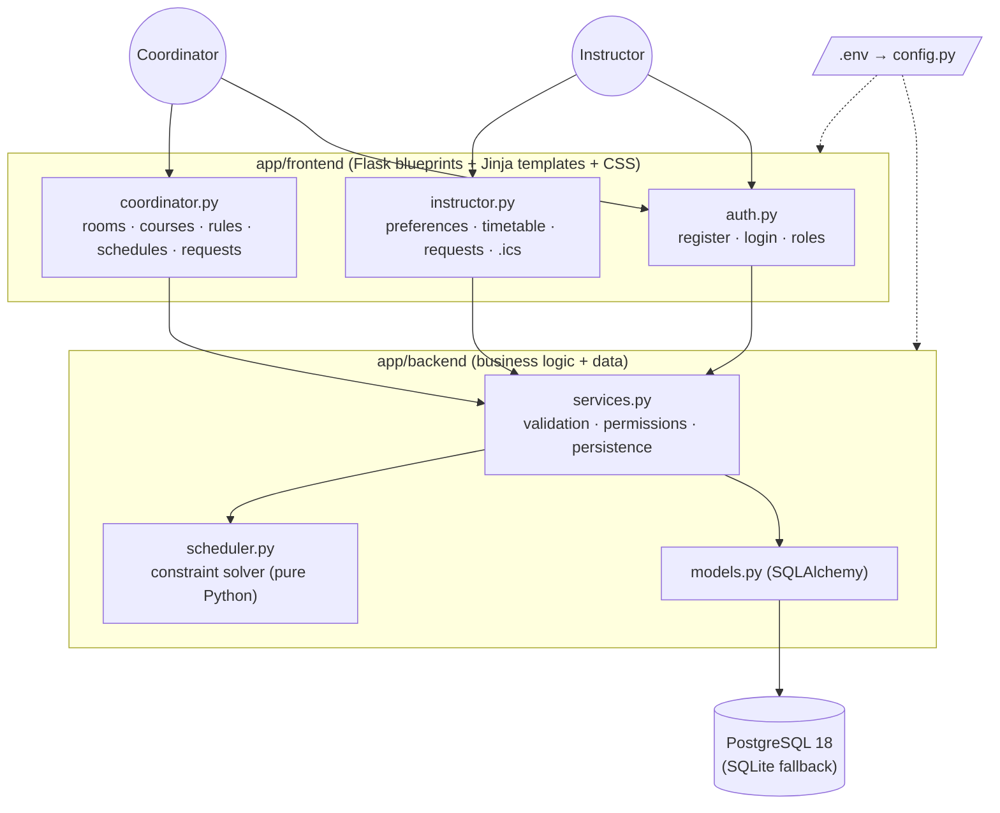
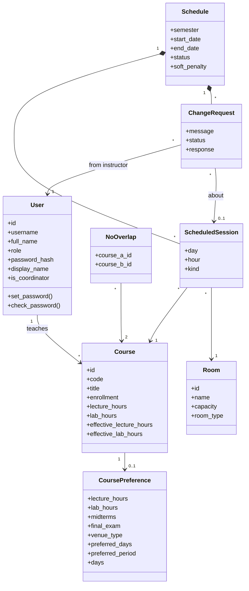
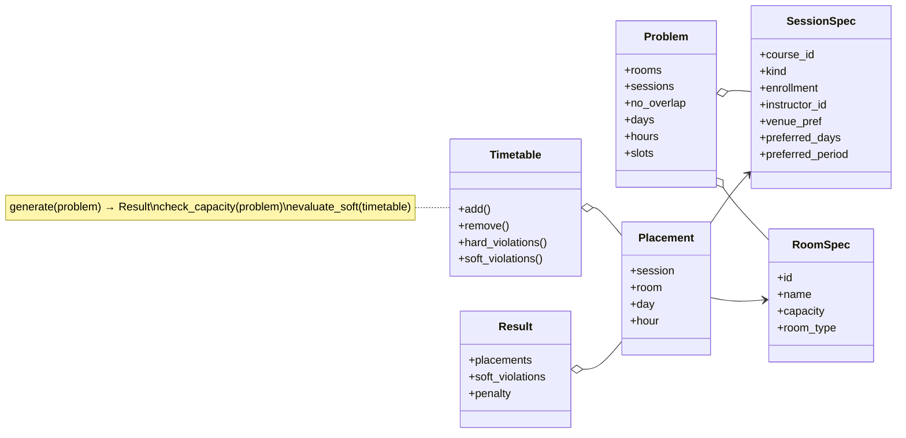
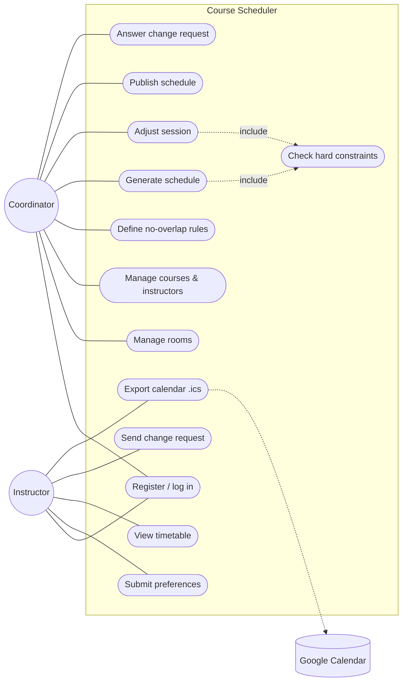
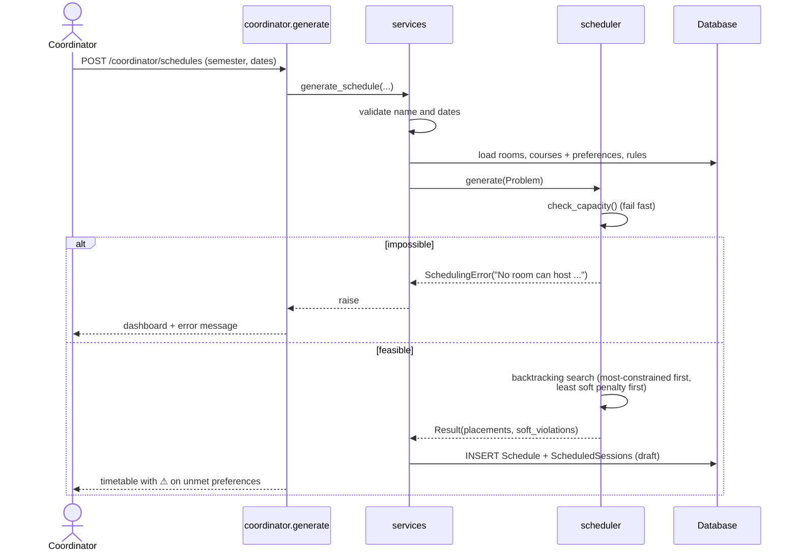
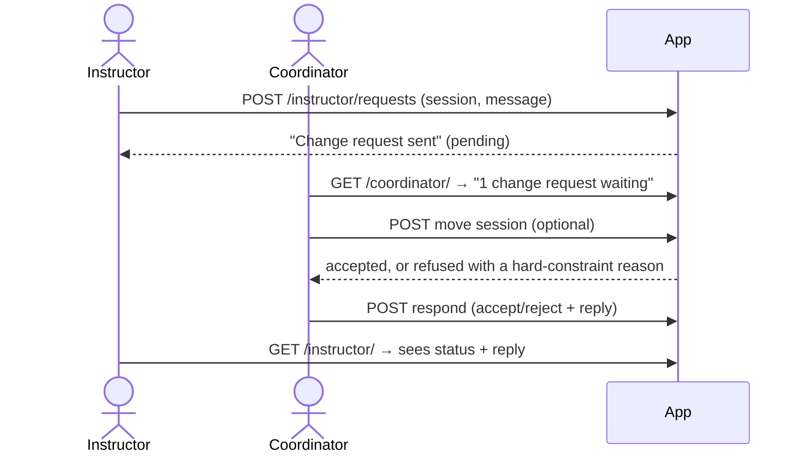

# Design Document — Course Scheduler

All diagrams are written in [Mermaid](https://mermaid.js.org/). GitHub renders them automatically. To export a PNG for a report, paste a diagram into <https://mermaid.live>.

## 1. Architecture

The app is a **monolith**: a single Flask application that is built, tested and deployed as one unit. A monolith suits a team of 3–4 and a one-semester project: one codebase, one process, no network calls between parts. Inside it, the code is split into two packages:

- **`app/frontend/`**: routes (Flask blueprints), Jinja templates and CSS. It handles HTTP and rendering only.
- **`app/backend/`**: models, business rules (`services.py`) and the scheduling algorithm. It has no routes or templates.

The frontend calls the backend and never the other way round. The scheduling algorithm has **no** Flask or database imports. `app/__init__.py` (the application factory) wires the two together, and `app/config.py` reads all settings from environment variables.

**Why this design**
- **The algorithm is isolated.** `scheduler.py` works on plain dataclasses (`RoomSpec`, `SessionSpec`, `Problem`), so it can be unit-tested exhaustively and swapped for a better solver later without touching the web code.
- **The service layer owns the rules.** Routes only translate HTTP requests into service calls and exceptions into flash messages or status codes (400/403/404).
- **Roles are enforced per blueprint.** Each blueprint's `before_request` calls `require_role`, so every coordinator route is protected, including any added later.

### Configuration and security

| Concern | How it is handled | Where |
|---|---|---|
| Secrets | `SECRET_KEY` and `COORDINATOR_CODE` come from `.env` (git-ignored). The app refuses to start if either is missing. `.env.example` documents every setting. | `app/config.py`, `run.py` |
| CSRF | Every POST form carries a `csrf_token`; requests without it are rejected with 400. | `CSRFProtect` in `app/__init__.py`, all templates |
| Debug mode | Taken from `FLASK_DEBUG`, never hardcoded. | `run.py` |
| Session cookie | `HttpOnly` (Flask default), `SameSite=Lax`, `Secure` when `SESSION_COOKIE_SECURE=1`. | `app/config.py` |
| Coordinator code | Compared in constant time (`hmac.compare_digest`). | `app/frontend/auth.py` |
| Passwords | Stored as salted hashes (Werkzeug). | `app/backend/models.py` |
| Dependencies | Exact versions pinned. | `requirements.txt` |
| Database | PostgreSQL via `DATABASE_URL` (psycopg 3 driver), with its own least-privilege `scheduler` role. SQLite is used when `DATABASE_URL` is empty. | `app/config.py`, `.env` |

### Design patterns
| Pattern | Where |
|---|---|
| Application Factory | `create_app()` in `app/__init__.py` |
| Service Layer | `services.py` |
| Strategy-ready solver | `scheduler.generate(problem)`: any function that takes a `Problem` and returns a `Result` can replace it |
| Data Transfer Objects | frozen dataclasses in `scheduler.py` |
| Template inheritance / macro | `base.html`, `_timetable.html` |
| Exception translation | `NotFoundError` → 404, `PermissionDenied` → 403, `ValidationError`/`ConflictError`/`SchedulingError` → flashed message |

## 2. Class Diagram

## 3. Use-Case Diagram

## 4. Sequence Diagram — Generate a Schedule

## 5. Sequence Diagram — Change Request

## 6. Scheduling Algorithm

**Model.** The week has 5 days × 10 one-hour slots, 50 slots in total. Each lecture hour or lab hour of a course is one *session*, and the solver assigns every session a *(room, day, hour)*.

| | Constraint | Checked in |
|---|---|---|
| H1 | room capacity ≥ enrollment | `room_suits`, `hard_violations` |
| H2 | labs only in lab rooms; lectures never in lab rooms | `room_suits`, `hard_violations` |
| H3 | a room holds one session per slot | `hard_violations` |
| H4 | an instructor teaches one session per slot | `hard_violations` |
| H5 | a course has at most one session per slot | `hard_violations` |
| H6 | no-overlap course pairs never share a slot | `hard_violations` |
| S1 | preferred days | `soft_violations` |
| S2 | preferred period (morning < 12:00 ≤ afternoon) | `soft_violations` |
| S3 | preferred venue type (lectures) | `soft_violations` |
| S4 | a course's sessions on different days | `soft_violations` |

**Search.**
1. `check_capacity` rejects inputs that are obviously impossible, before any search. Examples: no room is big enough, an instructor has more sessions than there are slots, or there are more lecture sessions than rooms × slots.
2. Sessions are ordered **most-constrained first**: fewest suitable rooms, then largest enrollment.
3. For each session, every legal (room, slot) is scored by the number of soft violations it would cause. Candidates are tried from lowest score upward, and ties go to the **smallest suitable room**, which keeps large rooms free for large classes.
4. If a session has no legal placement, the solver **backtracks**. A step limit (100,000 by default) stops pathological inputs from running forever.

This is a greedy best-first search with backtracking. It **guarantees** that every hard constraint holds, and it tries to minimise soft violations without guaranteeing the global minimum. Sprint 3 could add a local-search improvement pass (e.g. simulated annealing over the soft penalty).

**Complexity.** Scoring the candidates for one session costs O(rooms × slots × sessions in that slot). Without backtracking, a department-sized input (about 20 courses and 60 sessions) is solved in well under a second.

## 7. Testing Strategy

| Level | File | What / technique |
|---|---|---|
| Unit (algorithm) | `tests/test_scheduler.py` | Every hard and soft constraint; boundary values (enrollment = capacity vs. capacity + 1, 50 sessions in 50 slots); infeasible inputs |
| Unit (services) | `tests/test_services.py` | Validation (equivalence partitions), permissions, persistence, publishing, change requests, .ics content |
| Integration | `tests/test_routes.py` | Flask test client covering HTTP → service → DB, role access (403/302), what the user sees |
| Smoke | `tests/test_seed.py` | The demo data always produces a valid schedule |
| Security | `tests/test_security.py` | Missing secrets stop start-up, settings come from the environment, CSRF rejects forms without a token |
| CI | `.github/workflows/ci.yml` | Python 3.11–3.13 on SQLite, plus Python 3.13 on PostgreSQL 18, on every push and PR; fails if coverage drops below 85% |
